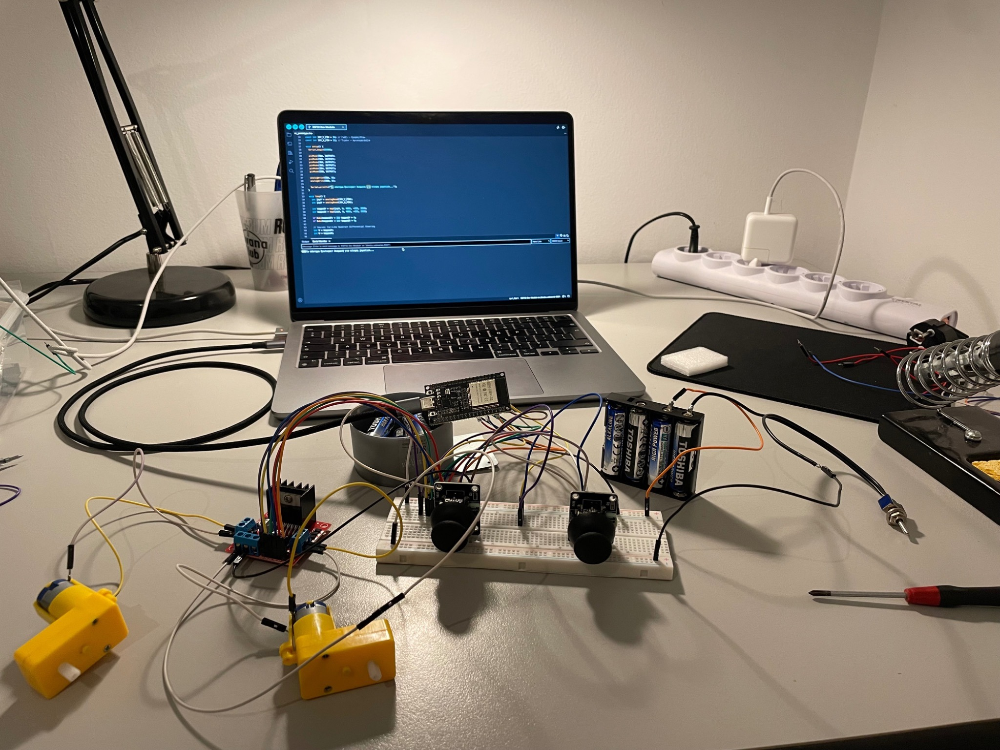

# ESP32 Bluetooth RC Car

A two-motor RC car prototype with a separate joystick controller. Two ESP32 boards exchange throttle and steering commands over Bluetooth Classic Serial.

The photo shows the bench prototype used to test the controls. The later two-board setup has a separate switched battery holder for each ESP32.

## Firmware

| Sketch | Board | Role |
| --- | --- | --- |
| [master_esp32.ino](firmware/master_esp32/master_esp32.ino) | Handheld controller | Reads throttle on GPIO 34 and steering on GPIO 32, then sends newline-terminated `Y,X` readings. |
| [slave_esp32.ino](firmware/slave_esp32/slave_esp32.ino) | Vehicle | Applies the joystick deadzone, mixes steering and throttle, and drives both motors through the motor driver. |

| Motor | PWM enable | Direction inputs |
| --- | --- | --- |
| Left | GPIO 14 | GPIO 27 and GPIO 25 |
| Right | GPIO 22 | GPIO 21 and GPIO 19 |

Throttle sets the outer motor's PWM in a turn. Steering reduces the inner motor's PWM in proportion to joystick deflection. Both motors stop when throttle is centered.

## Upload and test

1. Use Arduino IDE with the Arduino ESP32 board package and select your ESP32 board with Bluetooth Classic support.
2. Upload the slave sketch to the vehicle and the master sketch to the controller.
3. With the drive wheels off the ground, power on the vehicle, then the controller. The master looks for `ESP32_Robot_Slave`. Both sketches use a 9600 baud Serial Monitor.

## Project status

Bluetooth control and independent switched battery power have been tested on the prototype. The receiver currently retains its last motor command if packets stop arriving. A signal-loss failsafe is the next firmware task. LED lighting is planned.
